
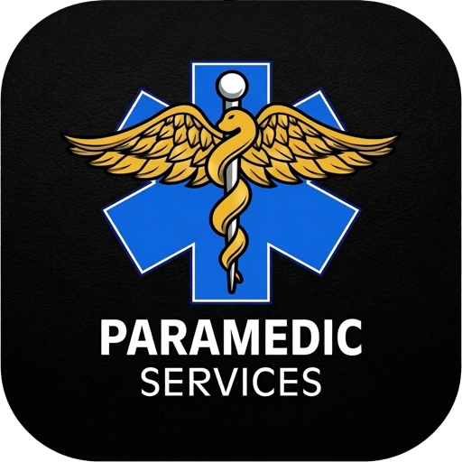

<h1 align="center">Directives</h1>

<b>Ontario Primary Care Paramedic medical directives, with every dose worked out for your patient.</b> 
ALS PCS 5.4 · BLS PCS 3.4 · Companion 5.4

<a href="https://icpryde.github.io/Primary-Care-Paramedic-Directives/"><b>Open the app</b></a> ·
<a href="https://github.com/icpryde/Primary-Care-Paramedic-Directives/releases/latest"><b>iPhone and Android downloads</b></a> ·
<a href="media/directives-trailer-v2.mp4"><b>Watch the trailer</b></a>

<a href="media/directives-trailer-v2.mp4">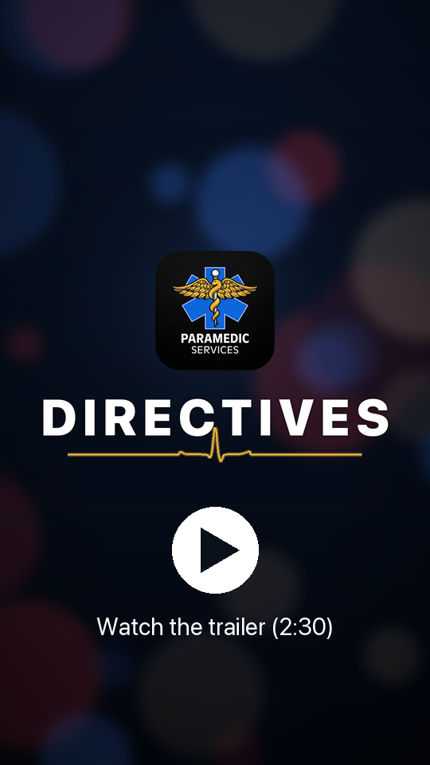</a>

## Version 2.0: a whole new app

Directives 2.0 is rebuilt from the ground up around one idea: set the patient once, and everything follows. Every directive, dose, contraindication and table comes from the same data as before; what changed is how fast you get to the answer.

<table>
<tr>
<td align="center" valign="top" width="25%">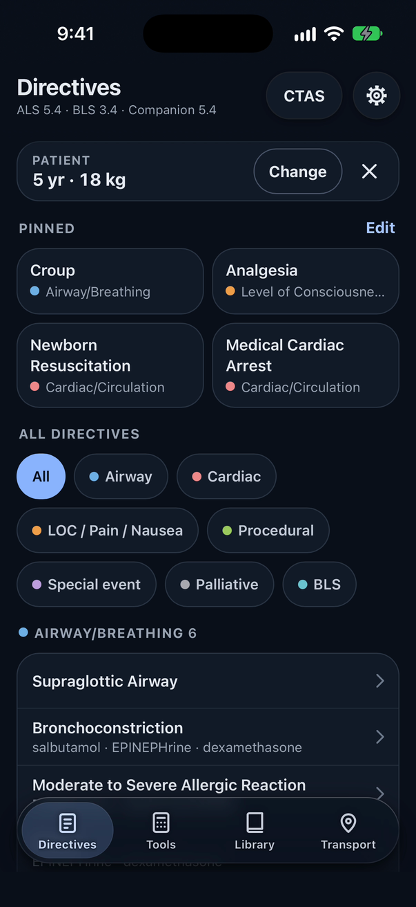 <b>Set the patient once</b> age, weight, or both</td>
<td align="center" valign="top" width="25%">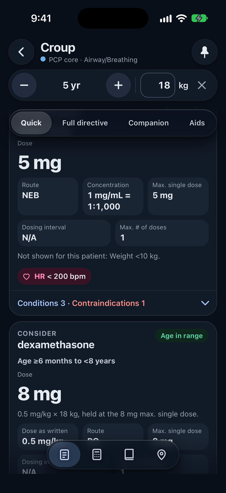 <b>Doses already worked out</b> and held at the max</td>
<td align="center" valign="top" width="25%">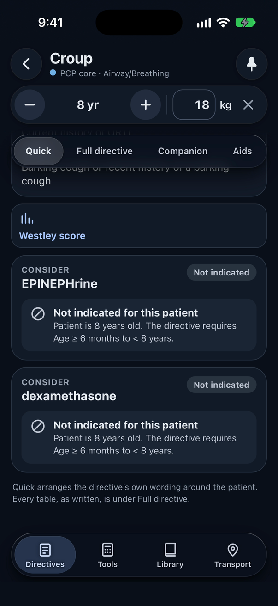 <b>It tells you what you can't give</b> and why</td>
<td align="center" valign="top" width="25%">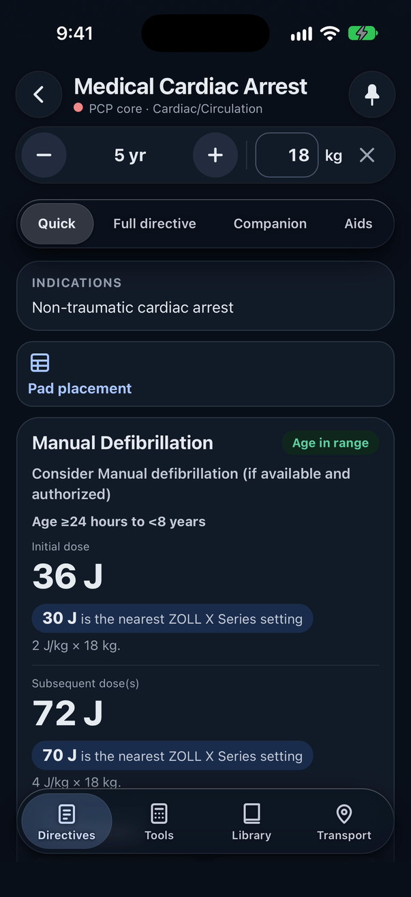 <b>Pediatric defibrillation</b> with the energies your monitor can select</td>
</tr>
<tr>
<td align="center" valign="top">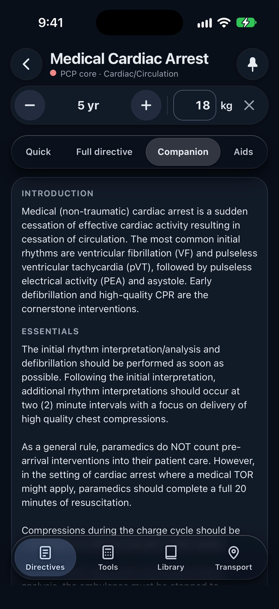 <b>Quick · Full directive · Companion · Aids</b> everything for a directive, one tab apart</td>
<td align="center" valign="top">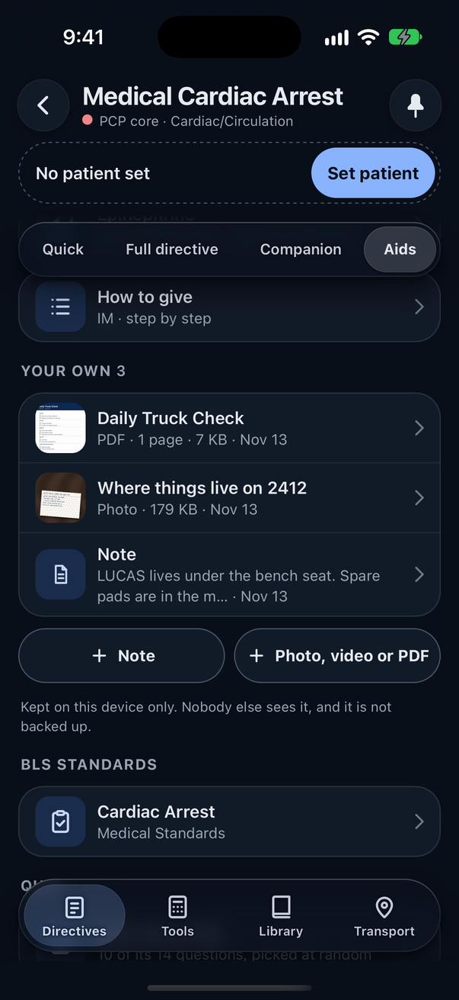 <b>Make it yours</b> your own notes, photos, videos and PDFs</td>
<td align="center" valign="top">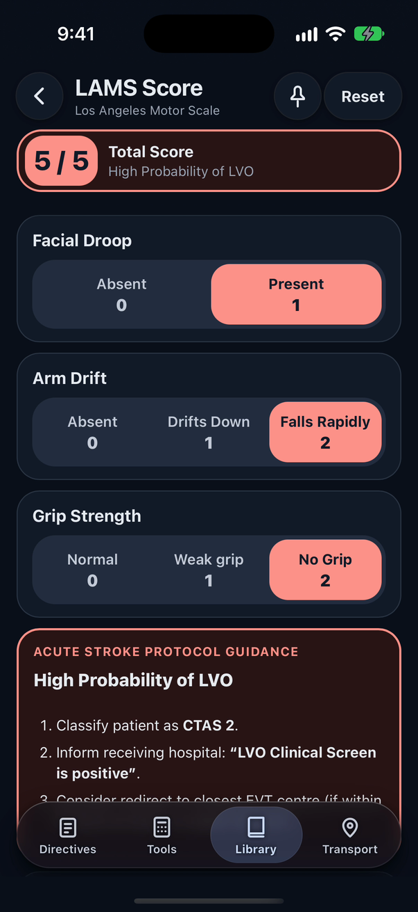 <b>65 BLS standards</b> with the scores built in</td>
<td align="center" valign="top">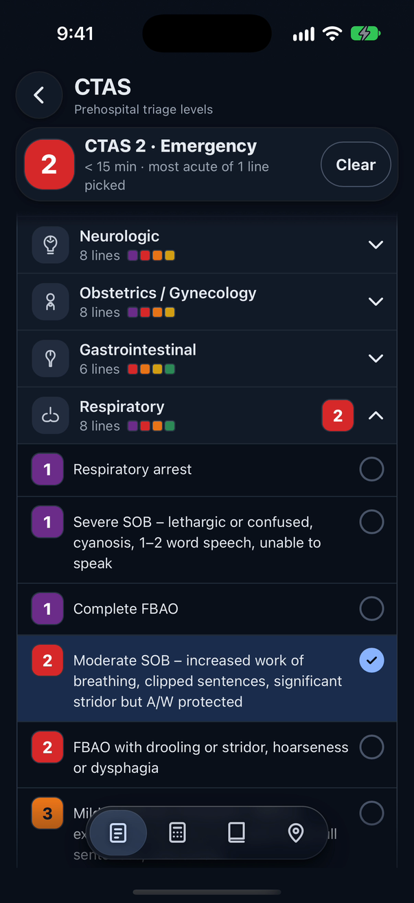 <b>CTAS</b> in a few taps</td>
</tr>
<tr>
<td align="center" valign="top">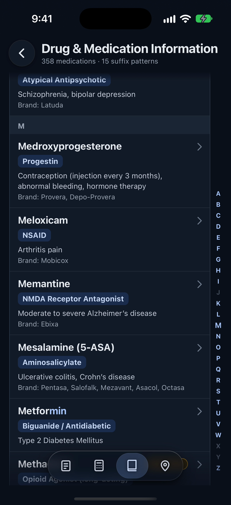 <b>358 medications</b> paramedic drugs and home medications</td>
<td align="center" valign="top">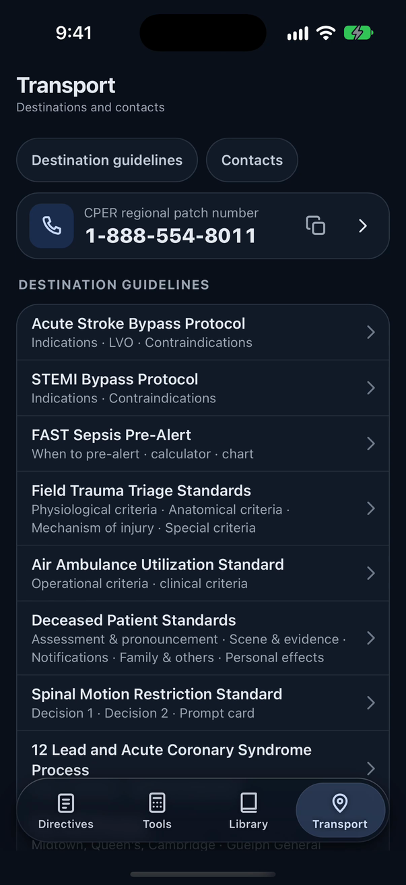 <b>Transport</b> destinations, bypass protocols, contacts</td>
<td align="center" valign="top">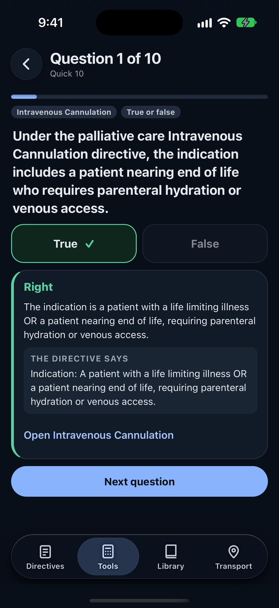 <b>A quiz to keep you sharp</b> 706 questions, each quoting the line it rests on</td>
<td align="center" valign="top">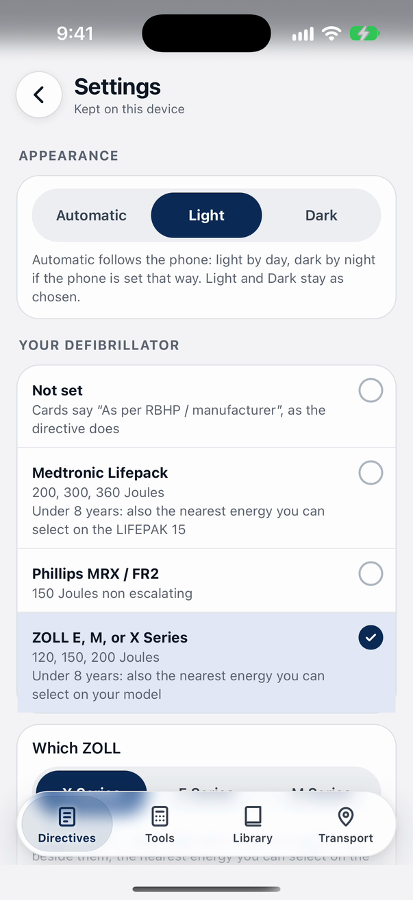 <b>Light and dark mode</b> and your own defibrillator</td>
</tr>
</table>

## What's in it

**Right dose, right now**
- One patient, set once by age, weight or both, carried into every directive, the search and the calculators.
- Each directive shows that patient's doses, worked out and held at the maximum dose, and says plainly when a drug is not indicated and why.
- Normal values for the patient's age, and pediatric defibrillation with the nearest energy your monitor can select (pick your defibrillator in Settings).

**Every directive, four tabs**
- **Quick**: what you need on a call. **Full directive**: the directive in full. **Companion**: its Companion Document section. **Aids**: charts, references, transport pages, skill videos, procedure sheets and your own files for that directive.

**Make it yours**
- Pin directives, BLS standards, calculators and medical references to Home.
- Add your own notes, photos, videos and PDFs to any directive or BLS standard. They stay on your device only.
- Keep your own contacts beside the regional contacts and patch numbers. One tap to call.

**Everything in one place**
- 36 directives (25 PCP, 4 special event, 7 palliative) and all 65 BLS Patient Care Standards.
- 358 medications, 9 calculators, 26 medical references, 20 procedure sheets from the Companion Document, 17 skill videos.
- CTAS, Transport (10 destination guidelines with bypass protocols, 8 contact pages, the CPER patch number), and a 706-question quiz.

**At home on your phone**
- Looks like an iPhone app on iPhone and an Android app on Android, in light or dark mode.
- Swipe back from the edge, pull down on Home to search everything, and it all works with no signal.

## Get the app

### iPhone or Android app
Download the latest `.ipa` (iPhone) or `.apk` (Android) from the [Releases page](https://github.com/icpryde/Primary-Care-Paramedic-Directives/releases/latest). Everything is inside the app, skill videos included, so it needs no signal.

- **iPhone:** sideload the `.ipa` with AltStore, Sideloadly, TrollStore, Feather or Xcode.
- **Android:** open the `.apk` on the phone and install it.

Version 2.0 installs over version 1 as an update.

### Web app (add to Home Screen)
Open **https://icpryde.github.io/Primary-Care-Paramedic-Directives/**
- **iPhone (Safari):** Share → **Add to Home Screen** → Add.
- **Android (Chrome):** ⋮ → **Install app** or **Add to Home screen**.

After the first visit the web app works with no signal. Skill videos play from the internet in the web app (the phone apps carry them).

### Updating
Close the app fully and open it again to get a new version. In the web app, open it once with signal.

## Coming from version 1

- **Your notes and pins come with you.** The first time 2.0 opens, notes you wrote in version 1 appear under that directive's Aids as "My Notes", and calculators and references you pinned are pinned on Home. Drug calculators you pinned (Croup, Dextrose, Epinephrine, Bronchoconstriction) bring their directive, which now works out those doses itself.
- **Version 1 is archived, not gone:**
  - Web: https://icpryde.github.io/Primary-Care-Paramedic-Directives/v1/
  - Code: the [`v1` branch](https://github.com/icpryde/Primary-Care-Paramedic-Directives/tree/v1)
  - iPhone and Android files: the [v1 archived release](https://github.com/icpryde/Primary-Care-Paramedic-Directives/releases/tag/v1.2.0-final)

## Disclaimer

This project is provided as a convenience reference only and is considered beta software. It is not an official Ministry of Health, base hospital, employer, or paramedic service product, and nothing here should be treated as a substitute for the current Ontario ALS or BLS Patient Care Standards, the Companion Document, your service’s policies, medical direction, or other authoritative sources. Clinical standards, protocols, and drug information change over time, and errors or omissions may be present in this app or repository.

You are solely responsible for confirming any information before you rely on it in practice. The author and contributors offer no warranty, express or implied, regarding accuracy, completeness, or fitness for any particular purpose, and they assume no liability for any loss, injury, or other outcome arising from use of or reliance on this software or its content. Use is entirely at your own risk.
